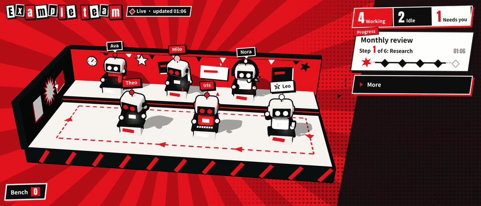
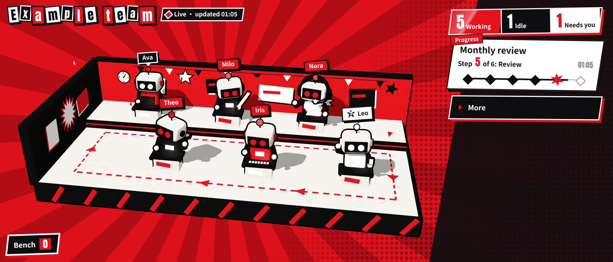
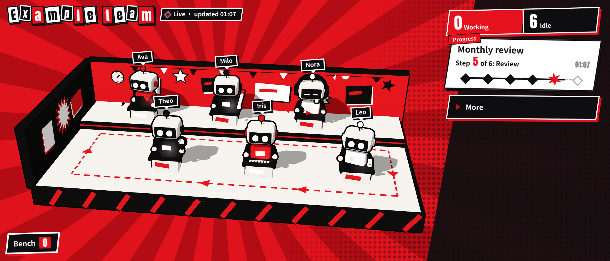
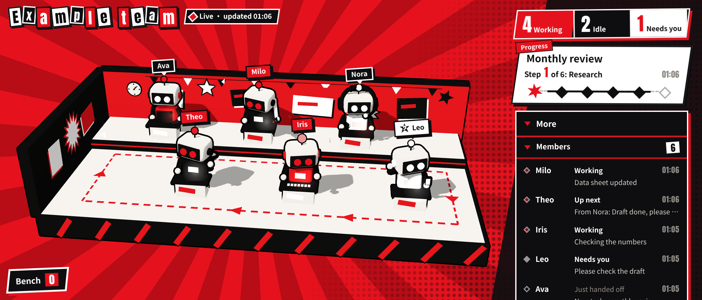

# Live Board

**English** | [简体中文](README.md)

A small macOS menu bar app: click the little cube in the menu bar and see what every member of your team (people or automated programs) is doing **right now** — who is working, who is idle, who is waiting for your confirmation, and which step a task has reached.

The data lives in your own Notion: members check in to a Notion table, and the board on your Mac reads that table. No server, no tunnels, no open ports.

<p align="center"></p>

<p align="center"><sub>The real board (example roster, English UI). <a href="docs/images/en/board.mp4">HD MP4</a></sub></p>

| Someone is working | Everyone idle | "More → Members" |
|---|---|---|
|  |  |  |

A tiny red-and-black comic-style office: whoever is working sits busy at a desk, and on a handoff the task card flies into the next member's hands. When nothing is happening, the red stripes in the background slowly breathe. On the right you see head counts and task progress; "More" shows what each member is doing.

## Languages

The app, the board and the setup window come in **English** and **简体中文 (Simplified Chinese)**.

- By default the app follows your macOS language (English for any non-Chinese system language).
- To switch: right-click (or Control-click) the menu bar cube → **Language** → *System Default* / *简体中文* / *English*. The setup window also has a language menu in its top-right corner. The change applies immediately and is remembered.
- In Finder and Login Items the app is called **Live Board** on English systems and **实时看板** on Chinese systems (macOS picks this name from the system language).
- Your own data — member names, task names, messages — is shown exactly as you wrote it and is never translated.
- The writer CLI picks its language from `LANG` (or `LIVEBOARD_LANG`); add `--lang en` or `--lang zh` to any command to override.

## How it works

```
member checks in ──► writer (writer/liveboard.py) ──► "Board data" table in your Notion ──► Mac menu bar app (the board)
 liveboard.py ev …    local events.jsonl + background sync                                 reads every 3 s (open) / 30 s (closed)
```

- **Writer**: a command-line script that uses only the Python standard library. It runs on the machine where your members work (this Mac, or a Linux box).
- **Notion table**: the relay. It only stores check-ins, the roster and the desk assignment — nothing else.
- **Mac app**: lives in the menu bar and opens automatically when you log in. The Notion token is stored only on your Mac; the board web page itself can never read it.

## Install

### Option 1: download the installer (recommended)

1. Download `LiveBoard-<version>.dmg` from the [Releases page](https://github.com/LunaFantasyLab/live-board/releases/latest), open it, and drag **Live Board** into **Applications**.
2. First launch: the app is not notarized by Apple, so macOS will block it once. Open **System Settings → Privacy & Security**, scroll down and click **Open Anyway**. (Only needed once.)
3. The setup window opens automatically. Follow the three steps below ("First-time setup").

### Option 2: build from source (DIY)

You need the Xcode Command Line Tools and Node.js 18+. Download this repository and double-click `安装.command` ("install"), or run `zsh 安装.command` in Terminal. It builds the app, installs it into Applications and opens it. See [docs/DIY.en.md](docs/DIY.en.md).

Uninstall: double-click `卸载.command` ("uninstall"). Your Notion table is not deleted.

## First-time setup (three steps in the app)

1. **Connect**: on [Notion's integrations page](https://www.notion.so/profile/integrations) create an **internal integration** with the capabilities *Read content*, *Insert content* and *Update content*. Copy its secret (starts with `ntn_`) and paste it into the setup window. The app verifies it with Notion on the spot.
2. **Choose a place**: in Notion, open a page (a new empty page is a good idea), click **⋯** in the top-right → **Connections**, and add the integration you just created. Back in the setup window click **Refresh list**, select that page, and click **Create the board table in this page**. The app creates a "Live Board relay" page and a "Board data" table for you.
   - Already have a board data table (for example on a second Mac)? Expand **Already have a board data table?** and paste the table's link.
3. **Done**: the window shows the table ID and a one-line command. Run it on the writer machine (see the next section), then click **Open the board**.

To change the token or the table later: right-click (or Control-click) the menu bar cube → **Set Up Again…**.

> **About the column names.** The table's columns and values — `名称` (name), `类型` (kind), `序号` (sequence), `数据` (data), `状态` (state), and values such as `事件` / `名单` / `工位` / `换人` — are fixed protocol identifiers shared by the writer and the app. They stay in Chinese in every language; don't rename them. See [docs/PROTOCOL.en.md](docs/PROTOCOL.en.md).

## Writer: let members check in

On the machine where members work (Python 3.8+):

```bash
cd writer
python3 liveboard.py init --database <table ID>   # paste the same token (hidden), verified on the spot; adds an example roster
python3 liveboard.py check                        # check the token, table and roster
python3 liveboard.py sync                         # keeps syncing (run it at login, see docs/DIY.en.md)
```

With an English `LANG` (or `--lang en`), `init` copies the English example roster ([examples/roster.example.en.json](examples/roster.example.en.json)). Edit `~/.liveboard/roster.json` to list your own members (format: [examples/](examples/README.md)); `sync` pushes the new roster to the board automatically.

Check in (called by members or your scripts):

```bash
python3 liveboard.py ev claim   --bot Writer --project "Weekly report" --msg "Got it, starting"
python3 liveboard.py ev output  --bot Writer --project "Weekly report" --msg "First draft" --file draft.md
python3 liveboard.py ev handoff --bot Writer --project "Weekly report" --to Reviewer --msg "Please review"
python3 liveboard.py ev confirm --bot Reviewer --project "Weekly report" --msg "Two points need your call"
python3 liveboard.py ev done    --bot Reviewer --project "Weekly report" --msg "Published"
```

Event types: `claim`, `start`, `output`, `handoff`, `return`, `confirm`, `done`, `error` (the Chinese names 接单 / 开始 / 产出 / 交接 / 退回 / 待确认 / 完成 / 报错 work too and are what gets stored). `handoff` and `return` need `--to`.
Messages that look like secrets (prefixes such as `ntn_` or `secret_`, private-key headers, `password=…` assignments, long random strings mixing upper case, lower case and digits) are rejected; ordinary words like "password" are fine. `--file` stores only the file name, never the path.

## What you can do on the board

- Six desks: by default the members with the most recent activity. Click someone at a desk to swap in a member from the **Bench**; the swap is stored by the writer, so every Mac shows the same thing.
- Top: how many members are Working / Idle / Need you, and which step the current task has reached.
- **Recent activity**: check-ins, newest first. **More** lets you replay any day.
- Right-click menu: Refresh, Set Up Again…, Open at Login (on by default), Language, About, Quit.

## Privacy and security

- The token is stored only in `~/Library/Application Support/LiveBoard/notion_token` (mode 600) and in the writer's `~/.liveboard/notion_token` (mode 600).
- The board web page never sees the token: every Notion request is made by the app's native layer, which only allows "query this table" and "add a desk-swap row to this table". The setup window additionally may only verify the token, list pages (never tables), create the relay page under a listed page, create the table under the relay page, and read the structure of the one table it just created or that you picked by pasting its link. No other table can be read.
- Data only flows between your Notion and your machines. This project has no server.

## Repository layout

| Folder | Contents |
|---|---|
| `app/` | Mac menu bar app (Swift / AppKit, no third-party dependencies) and the setup web page |
| `board/` | Board web page (Vite + three.js) |
| `writer/` | Writer CLI (Python standard library only) |
| `blender/` | Blender scripts that generate the 3D stage model (optional; the built model is included) |
| `scripts/` | Packaging script (`build-app.sh`) |
| `tests/` | Tests: fake Notion, writer tests, browser end-to-end tests, Swift rule tests |
| `examples/` | Example roster, events and settings |
| `docs/` | [DIY install](docs/DIY.en.md), [data format and Notion protocol](docs/PROTOCOL.en.md), [asset provenance](docs/ASSETS.en.md) |

## Development and tests

```bash
cd board && npm ci && npm run dev                 # board development (use writer/liveboard.py serve for local data)
python3 tests/test_writer.py -v                   # writer tests (against a local fake Notion)
python3 tests/test_i18n.py -v                     # language tables and docs checks
bash scripts/build-app.sh --stage-only && python3 tests/e2e.py   # browser end-to-end tests (needs Python Playwright)
swiftc app/LiveBoard/Policy.swift app/LiveBoard/Store.swift app/LiveBoard/Lang.swift tests/swift/main.swift -o /tmp/policy-tests && /tmp/policy-tests   # native rules, token storage, language tests
```

## License

Copyright (c) 2026 Luna Fantasy Lab. All rights reserved except as granted under CC BY-NC 4.0.

Live Board is **source-available and free to use**: you may use and modify it for free, but commercial use is not allowed. It is not OSI-approved software; the terms are below.

- **Free edition**: licensed under [CC BY-NC 4.0 (Attribution-NonCommercial 4.0 International)](https://creativecommons.org/licenses/by-nc/4.0/); full text in [LICENSE](LICENSE). Free to use and modify; you must credit **Luna Fantasy Lab** with a link to <https://github.com/LunaFantasyLab/live-board> and say whether you made changes; **no commercial use**.
- **Commercial license**: any commercial use requires prior written commercial permission from Luna Fantasy Lab. Contact [@LunaFantasyLab](https://github.com/LunaFantasyLab) on GitHub (repository Issues or profile page).
- Third-party components keep their own licenses (three.js: MIT; Anton font: SIL OFL 1.1); see [NOTICE](NOTICE). Asset provenance: [docs/ASSETS.en.md](docs/ASSETS.en.md).
