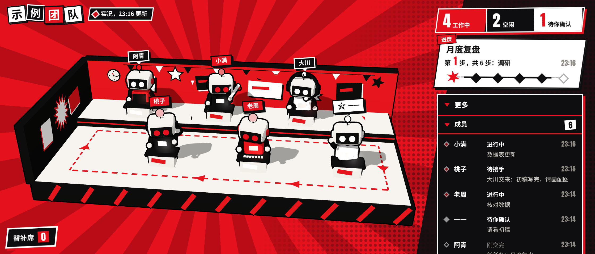

# 实时看板（Live Board）

[English](README.en.md) | **简体中文**

一个 Mac 菜单栏小工具：点一下菜单栏里的小立方体，就能看到团队里每个成员（人或自动化程序都行）**此刻在做什么**——谁在工作、谁空闲、谁在等你确认、任务走到了第几步。

数据放在你自己的 Notion 里：成员打卡写到一张 Notion 表，Mac 上的看板从这张表读。不需要服务器，不需要内网穿透，也不需要开端口。

<p align="center"></p>

<p align="center"><sub>看板实际画面（示例名单）。<a href="docs/images/board.mp4">高清 MP4</a></sub></p>

| 有人在工作 | 全员空闲 | 点开「更多 → 成员」 |
|---|---|---|
|  |  |  |

红黑漫画风的小办公室：谁在干活就坐在工位上忙，交接时任务卡会飞到下一位手里；没人动的时候背景红条纹慢慢呼吸；右侧是人数、任务进度，点「更多」能看每个成员在做什么。

## 语言

App、看板和设置窗口都有 **简体中文** 和 **English** 两种界面。

- 默认跟随 macOS 系统语言（系统是中文就显示中文，其他语言显示英文）。
- 手动切换：右键点菜单栏小立方体（或按住 Control 点）→「语言（Language）」→「跟随系统 / 简体中文 / English」；设置窗口右上角也能选。当场生效，会记住。
- 访达和登录项里的 App 名字跟随系统语言：中文系统叫「实时看板」，英文系统叫「Live Board」。
- 你自己的数据（成员名、任务名、消息）原样显示，不翻译。
- 写入端按 `LANG`（或 `LIVEBOARD_LANG`）选提示语言；任何命令加 `--lang zh` / `--lang en` 可以指定。

## 它是怎么工作的

```
成员打卡  ──►  写入端（writer/liveboard.py）──►  你的 Notion「看板数据」表  ──►  Mac 菜单栏 App（看板）
 liveboard.py ev …     本机 events.jsonl + sync 常驻同步                         每 3 秒（打开时）/ 30 秒（收起时）读一次
```

- **写入端**：一个只用 Python 标准库的命令行脚本，跑在成员们干活的那台机器上（可以就是这台 Mac，也可以是一台 Linux）。
- **Notion 表**：中转站。只存打卡记录、名单和工位，不存别的。
- **Mac App**：菜单栏常驻，登录 Mac 后自动打开。连接密钥只保存在本机，看板网页本身读不到密钥。

## 安装

### 方式一：下载安装包（推荐）

1. 到 [Releases 页面](https://github.com/LunaFantasyLab/live-board/releases/latest) 下载 `LiveBoard-<版本>.dmg`，双击打开，把「实时看板」拖进「应用程序」。
2. 第一次打开：这个 App 没有经过 Apple 公证，macOS 会拦一下。打开「系统设置 → 隐私与安全性」，在最下面点「仍要打开」。（只需要一次。）
3. 打开后会自动弹出设置窗口，按提示做三步（见下面「第一次设置」）。

### 方式二：从源码装（DIY）

需要 Xcode 命令行工具和 Node.js 18+。下载这个仓库后双击 `安装.command`（或在终端运行 `zsh 安装.command`）。它会构建、装进「应用程序」并打开。详见 [docs/DIY.md](docs/DIY.md)。

卸载：双击 `卸载.command`。Notion 里的表不会被删。

## 第一次设置（App 里的三步）

1. **连接**：到 [Notion 的连接管理页](https://www.notion.so/profile/integrations) 新建一个「内部连接」，权限勾上「读取内容」「插入内容」「更新内容」，复制它的密钥（`ntn_` 开头），贴进设置窗口。App 会当场找 Notion 验证。
2. **选位置**：在 Notion 里打开一个页面（建议新建一个空页面），点右上角「⋯」→「连接」，选刚建的连接。回到设置窗口点「刷新列表」，选中这个页面，点「在这个页面里新建看板表」。App 会自动建好「实时看板中转」页面和「看板数据」表。
   - 已经有看板数据表了（比如换了一台 Mac）？展开「已经有看板数据表了？」，贴上表的链接即可。
3. **完成**：窗口会给出表 ID 和一行命令，在写入端那台机器上运行它（见下一节），然后点「打开看板」。

以后想换密钥或换表：右键点菜单栏小立方体（或按住 Control 点）→「重新设置…」。

## 写入端：让成员打卡

在成员干活的机器上（需要 Python 3.8+）：

```bash
cd writer
python3 liveboard.py init --database <表ID>   # 粘贴同一个连接密钥（不回显），当场验证；会放一份示例名单
python3 liveboard.py check                     # 检查密钥、表、名单
python3 liveboard.py sync                      # 常驻同步（建议做成开机自启，见 docs/DIY.md）
```

改名单：编辑 `~/.liveboard/roster.json`（格式见 [examples/](examples/README.md)），`sync` 会自动把新名单推到看板上。

打卡（成员或你的脚本调用）：

```bash
python3 liveboard.py ev 接单   --bot 写手 --project 周报 --msg "收到，开始写"
python3 liveboard.py ev 产出   --bot 写手 --project 周报 --msg "初稿" --file 初稿.md
python3 liveboard.py ev 交接   --bot 写手 --project 周报 --to 审核员 --msg "请审"
python3 liveboard.py ev 待确认 --bot 审核员 --project 周报 --msg "两处要你拍板"
python3 liveboard.py ev 完成   --bot 审核员 --project 周报 --msg "已发布"
```

事件类型：接单、开始、产出、交接、退回、待确认、完成、报错（也可以写英文 claim / start / output / handoff / return / confirm / done / error）。
消息里出现像密钥的内容（`ntn_`、`secret_` 这类前缀、私钥头、`password=…` 这类写法、大小写字母和数字混在一起的长随机串）会被拒收，「密码」「密钥」这样的普通词不受影响；`--file` 只记文件名，不记路径。

## 看板上能做什么

- 6 个工位：默认按最近有动态的成员排；点工位上的人可以从「替补席」换人，换人结果存在写入端，所有 Mac 看到的一样。
- 顶部：工作中 / 空闲 / 待你确认 的人数；当前任务走到第几步。
- 「最近动态」：按时间倒序的打卡记录；「更多」里可以按天回放。
- 右键菜单：刷新、重新设置…、登录时自动打开（默认开）、语言、关于、退出。

## 隐私与安全

- 连接密钥只存在 `~/Library/Application Support/LiveBoard/notion_token`（权限 600）和写入端的 `~/.liveboard/notion_token`（权限 600）。
- 看板网页拿不到密钥：所有 Notion 请求都由 App 原生层代发，而且只放行「查这张表」和「在这张表里加换人行」；设置窗口另外只放行验证密钥、只列页面（列不出表）、在列出来的页面下建中转页、在中转页下建表，以及读这次新建或你粘贴链接选定的那一张表的结构；别的表一律读不到。
- 数据只在你的 Notion 和你的机器之间流动，这个项目没有任何服务器。

## 目录

| 目录 | 内容 |
|---|---|
| `app/` | Mac 菜单栏 App（Swift / AppKit，无第三方依赖）和设置向导网页 |
| `board/` | 看板网页（Vite + three.js） |
| `writer/` | 写入端命令行（只用 Python 标准库） |
| `blender/` | 生成 3D 舞台模型的 Blender 脚本（可选，仓库里已带做好的模型） |
| `scripts/` | 打包脚本（`build-app.sh`） |
| `tests/` | 测试：假 Notion、写入端测试、浏览器端到端测试、Swift 规则测试 |
| `examples/` | 示例名单、事件、设置 |
| `docs/` | [DIY 安装](docs/DIY.md)、[数据格式与 Notion 协议](docs/PROTOCOL.md)、[素材来源](docs/ASSETS.md)（英文版：`*.en.md`） |

## 开发与测试

```bash
cd board && npm ci && npm run dev                 # 看板网页开发（配合 writer/liveboard.py serve 提供本机数据）
python3 tests/test_writer.py -v                   # 写入端测试（用本机假 Notion）
python3 tests/test_i18n.py -v                     # 中英文字符表、文档检查
bash scripts/build-app.sh --stage-only && python3 tests/e2e.py   # 浏览器端到端测试（需要 Python Playwright）
swiftc app/LiveBoard/Policy.swift app/LiveBoard/Store.swift app/LiveBoard/Lang.swift tests/swift/main.swift -o /tmp/policy-tests && /tmp/policy-tests   # 原生层放行规则、密钥保存测试
```

## 许可

Copyright (c) 2026 Luna Fantasy Lab. All rights reserved except as granted under CC BY-NC 4.0.

本项目免费公开源码：可以免费使用和修改，禁止商业用途，具体条款见下。

- **免费版**：按 [CC BY-NC 4.0（署名-非商业性使用 4.0 国际）](https://creativecommons.org/licenses/by-nc/4.0/deed.zh-hans) 授权，全文见 [LICENSE](LICENSE)。可以免费使用和修改，须署名 **Luna Fantasy Lab** 并附仓库链接 <https://github.com/LunaFantasyLab/live-board>，**禁止商业用途**。
- **商业授权**：任何商业使用，须事先获得 Luna Fantasy Lab 的书面商业授权。请通过 GitHub 联系 [@LunaFantasyLab](https://github.com/LunaFantasyLab)（仓库 Issues 或主页）。
- 第三方组件沿用各自的许可（three.js：MIT；Anton 字体：SIL OFL 1.1），详见 [NOTICE](NOTICE)；素材来源见 [docs/ASSETS.md](docs/ASSETS.md)。

